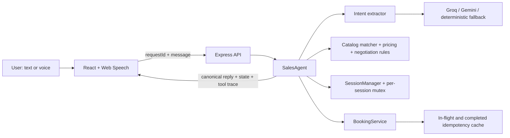
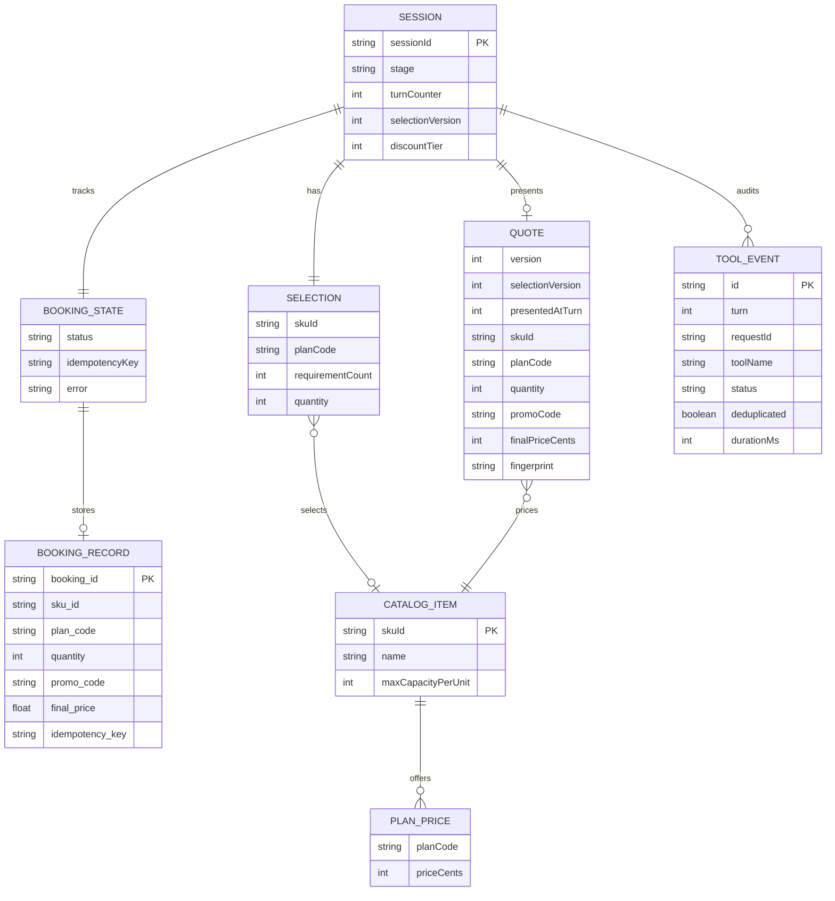
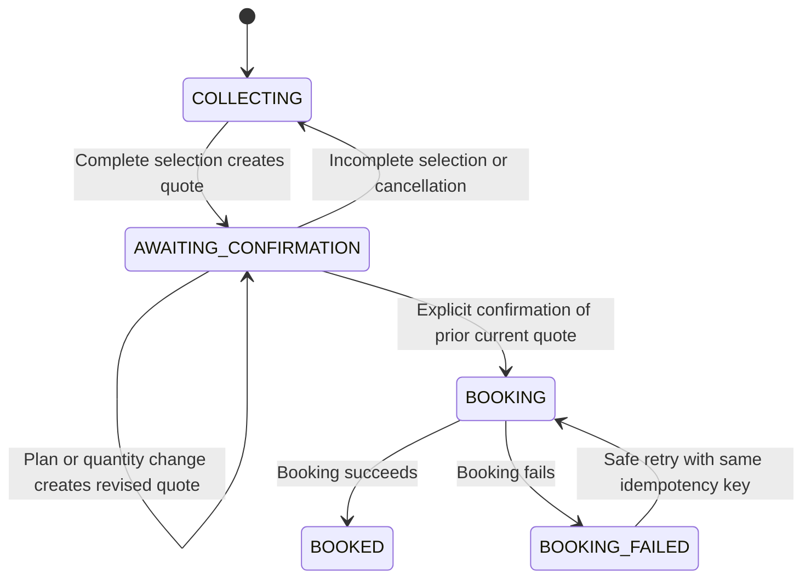

# Architecture Preview — HLD and LLD

## High-level design

The application is a React sales console backed by an Express API. The language model only extracts intent; deterministic TypeScript code owns every transactional decision.

Source layout: `client/` contains the React app, `server/` contains Express and business rules, and `tests/` contains integration and guardrail checks.

Trust boundary: model output is treated as untrusted intent data. Zod validates it, catalog allowlists resolve products and plans, and the model never receives booking authority.

## Main components

| Component | Responsibility |
|---|---|
| React app | Typed chat UI, push-to-talk, spoken canonical replies, state and tool inspection |
| Express API | Validates requests, exposes catalog/session/booking routes, serves the production SPA |
| Intent extractor | Returns schema-constrained product, plan, requirement, objection, confirmation and cancellation intent |
| Catalog matcher | Normalizes safe aliases and rejects unknown or ambiguous products |
| Pricing module | Ceiling quantity math and integer-cent discount calculations |
| SalesAgent | Applies the state machine and renders deterministic customer messages |
| SessionManager | Stores sessions, serializes turns with a mutex and caches duplicate request responses |
| BookingService | Revalidates booking payloads and deduplicates in-flight and completed bookings |

## Logical schema diagram

These are the in-memory TypeScript objects, not database tables. Each session has one current selection and booking state, at most one current quote and booking record, and an append-only list of tool events.

`skuId`, `planCode`, and `promoCode` values are restricted by the catalog and discount rules. Nullable fields in `Selection`, `Quote`, and `BookingState` represent a conversation that has not reached that step yet. The quote fingerprint becomes the booking idempotency key after explicit confirmation.

## Low-level request flow

1. React creates a session with `POST /api/sessions`.
2. A typed or finalized voice message gets a unique `requestId`.
3. Express validates `{ requestId, message }` and calls `SalesAgent.handleMessage()`.
4. The session mutex serializes the complete turn.
5. The intent adapter returns only structured intent; a failure makes the request fail closed before state mutation.
6. Deterministic code resolves the SKU, validates the plan, calculates `ceil(requirement / capacity)` and prices in cents.
7. The agent applies discount, quote-version and confirmation rules.
8. A valid later-turn confirmation derives an idempotency key from the session and quote fingerprint.
9. `BookingService` independently recomputes the expected price before creating one booking.
10. React receives `{ assistantMessage, state, toolCalls, turnVersion }` and displays the exact audit trail.

## State machine

Important invariants:

- A quote records both `selectionVersion` and `presentedAtTurn`.
- Confirmation is valid only when the quote matches the current selection and was presented on an earlier turn.
- SKU changes reset the discount tier; plan and quantity changes preserve an earned tier but require a new quote.
- Discounts advance only `0% → SAVE10 → CLOSENOW15`.
- Requirement changes are processed before confirmation, so “switch to seven rooms and book it” cannot book stale parameters.
- Unknown or ambiguous product requests clear the prior selection, preventing a later “yes” from booking an old quote.

## Idempotency and concurrency

Two protections operate independently:

1. The session mutex and `requestId` response cache serialize chat turns and replay duplicate requests.
2. `BookingService` stores the payload hash plus both the in-flight promise and completed result for each idempotency key.

Therefore two rapid confirmations, duplicate request IDs or repeated direct booking calls cannot create two bookings. Reusing a key with a different payload is rejected.

## Frontend and deployment

- Development: Vite serves React and proxies `/api` and `/health` to Express.
- Production: Vite builds to `dist/client`; Express serves the SPA and API from one process.
- Voice: browser Web Speech provides zero-cost transcription and synthesis. Final transcripts enter the same message endpoint as typed turns.
- Persistence: sessions, locks and bookings are intentionally in memory for the single-process challenge. Redis/database persistence and distributed locks are production follow-ups.
